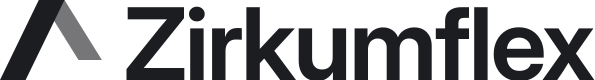

# Zirkumflex Brand

<picture>
  <source media="(prefers-color-scheme: dark)" srcset="logo/lockup-white.svg">
  
</picture>

The logo, colours and design tokens shared by zirkumflex-group projects: a starting point, not a rulebook. This repo is the source of truth. Projects, Flexspeak included, follow it.

**See it:** https://zirkumflex-group.github.io/brand/

## The group and its products

- **The mark** (the circumflex as a folded ribbon) and **the indigo** belong to Zirkumflex. Use them unchanged, with the name, for the group itself.
- **A badge** is a product's app icon: a picture with the mark in it, or the mark over the product's letter. Flexspeak, the first product, wears the group's indigo.

## A new product

A separate website or app gets an icon of its own, in the group's colours. In order of preference: a picture of what the product is for with the caret in it, the product's letter under the caret until a picture fits, and a colour of its own on top when the product has its own standing. From a checkout of this repo:

```sh
# A picture: a built-in one by name (so far: file), or the product's own drawing.
node scripts/product.mjs --name "Files" --picture file --out ../files/brand
node scripts/product.mjs --name "Product" --picture drawing.svg --out ../product/brand
# No picture yet: the product's letter under the caret.
node scripts/product.mjs --name "Docs" --letter D --out ../docs/brand
# Its own colour: icons in that hue, and the palette to match.
node scripts/product.mjs --name "Product" --hue 350 --out ../product/brand
# A colour with a picture or letter, taking the hue of a colour you already have, and adding the outlined lockup:
bun scripts/product.mjs --name "Product" --letter P --colour "#b0266a" --font path/to/Inter.ttf --out ../product/brand
```

Drawing a picture:

- One object the product is for (a file for a place that keeps files), centred.
- The caret is in the picture: printed on the object, or doing a job in it (a roof, an arrow, a fold). It keeps its shape and slant. A picture set beside the caret is two icons, each half the size; merge them.
- The object takes the ribbon's pale colours, the caret on it the badge's deep ones.
- The file is an SVG with `viewBox="0 0 64 64"`, without a background, drawn within 30 units of the centre with no part thinner than 4. Use the group's logo colours from `tokens.json`; the tool swaps them for the product's when it has a hue. `fill="url(#front)"` gives the front ribbon's gradient. Run the tool with `--picture file` to see a finished one.
- Judge it at 16 px beside its siblings (the identity page's tab strip does this). If it blurs or two look alike, simplify.
- A picture that doesn't fit is worse than a letter. Ship the letter and swap it later.

The letter (A to Z or a digit) sits under the caret, the way a circumflex sits over a letter; the caret and the colours stay the group's. Two sites with the same letter take a digit, another letter of the name, or a colour. The tool refuses to write the plain caret on indigo: that is the group's, and Flexspeak's as the first product.

It writes `badge.svg`, `tile.svg` and `maskable.svg`, plus the lockups when `--font` is given. With a hue it also writes `product.css` and fails if the accent misses a contrast floor. Panels keep the default palette's luminance, so every other floor carries over. Import `product.css` after `tokens.css`. The [identity page](https://zirkumflex-group.github.io/brand/#yours) does the same live.

| | Rule |
| --- | --- |
| Keep | The mark's shape (a pale ribbon on a deep colour), what the status colours mean, the contrast floors, Inter for interface text |
| Every product changes | Its icon: a picture with the caret in it, or its letter under the caret. Its lockup (its badge with its name). The plain caret on indigo is for the group's own pages, never a product's icon |
| Change if it helps | The colour of its icon, and with it the accent and panels; a display face; radius and density |

Things to check in a product:

- Its favicon and header icon are its own tile, not `logo/tile.svg` from this repo.
- The accent fills one main action per view and marks selection and focus. Labels that repeat down a list are `muted`; a second button is a plain one.
- Green, amber and red appear only as status. Decorative icons use text colours or `chart-*`.
- A display face sets the product's name and the top heading only. Section headings, buttons and data stay in Inter.
- The icon is one picture with the caret in it, or the caret over one letter or digit. Never a picture beside the caret.
- If the hue sits next to a status colour (the tool says so), use it for the badge and keep the default accent.

Icon files by place:

| Place | File | Mind |
| --- | --- | --- |
| Browser tab | `tile.svg` as the favicon | Has to hold at 16 px |
| Installed web app | PNGs from `tile.svg` (such as 192 and 512 px) and one from `maskable.svg` | Only the centre circle, 80% of the width, is safe; use that file for `"purpose": "maskable"` alone |
| Windows app | `.ico` from `badge.svg` | At least 16, 24, 32, 48 and 256 px |
| macOS app | A layered icon, as in `logo/flexspeak-macos.icon` | Ribbon legs as separate layers |
| Beside the name | `lockup.svg`, or its `-white` / `-ink` file | Don't rebuild it from live text |

## What's in it

| File | What it is |
| --- | --- |
| `tokens.json` | The source of truth: colours (dark and light), chart series, shadows, logo colours, fonts, type scale, radius, spacing, sizes, motion |
| `tokens.css` | The same as CSS custom properties, `--zx-*`. Generated |
| `shadcn.css` | shadcn/ui names (`--background`, `--primary`, `--chart-1` …) mapped onto `--zx-*`. Generated |
| `logo/mark.svg` | The mark in `currentColor`, for inlining |
| `logo/mark-white.svg`, `mark-ink.svg` | The mark for dark and for light backgrounds |
| `logo/mark-solid.svg` | The mark in one flat ink (`currentColor`), for print, stamps and embroidery |
| `logo/lockup.svg` | The mark and "Zirkumflex", outlined, in `currentColor` for inlining; `-white` and `-ink` for use as images |
| `logo/tile.svg` | The mark on a square tile, for favicons |
| `logo/flexspeak.svg`, `flexspeak.ico` | Flexspeak's round badge |
| `logo/lockup-flexspeak.svg` | Flexspeak's badge and name, outlined; `-white` and `-ink` as above |
| `logo/flexspeak-macos.icon/` | Flexspeak's layered macOS app icon |
| `index.html` | The identity page, built from `tokens.css` |

## Use it

Web projects (Bun, npm, pnpm):

```sh
bun add github:zirkumflex-group/brand
```

```css
@import "@zirkumflex/brand/tokens.css";
/* shadcn/ui or Tailwind v4 apps also: */
@import "@zirkumflex/brand/shadcn.css";
```

Dark is the default. Put `class="light"` or `data-theme="light"` on `<html>` for the light palette, or `data-theme="system"` to follow the OS. With shadcn/ui, set `class="dark"` or `class="light"` explicitly: its `dark:` variant looks for the class, not the default.

Swift, Rust and scripts read `tokens.json`. Agents in other repos can read any file without cloning:

```sh
gh api repos/zirkumflex-group/brand/contents/tokens.json -H "Accept: application/vnd.github.raw"
```

## Principles

Defaults, not laws. Bend them where a project's medium needs it, and keep the family resemblance.

- Colour carries meaning. The accent marks the main action, focus and selection; green, amber and red are for status, not decoration. Charts use the chart series.
- Structure before boxes. Space, a heading or a hairline first; a card when something really stands alone; shadows for things that float.
- Calm by default. Short, plain labels. Pick the density that suits the medium.
- Honest state. Stale or unknown data never looks healthy.
- Make it yours. Every product has its own icon, a picture with the caret in it or its letter; the accent, a display face, radius and density are its to change. Keep the mark and what the status colours mean.

The defaults: Inter for interface text, radius 10 for cards and 6 for controls, 28 px controls on a desktop.

## Contrast

`bun run check` holds both palettes to these floors (WCAG 2 ratios). Text colours are checked on every panel and on controls (`raised`); status words and chart marks on the panels they appear on:

| Colour | Floor |
| --- | --- |
| `text` | 7:1 |
| `muted`, `accent`, text on the accent | 4.5:1 |
| Status colours, as words on panels (`poor` also on controls) | 4.5:1 |
| `faint` (timestamps, hints only) | 3:1 |
| `cpu`, `ram`, `chart-*` (marks, not text) | 3:1 |

`chart-1`…`chart-5` were chosen so neighbours stay apart under the common colour-vision deficiencies, in their listed order (worst adjacent pair ΔE 8.8 in light, 11.7 in dark, OKLab ×100). Assign series in that order rather than picking freely, and re-validate if you change one; the check above covers contrast only.

## Changing it

1. Edit `tokens.json` (or a file in `logo/`).
2. `node scripts/build.mjs` regenerates `tokens.css` and `shadcn.css`.
3. `bun run check` confirms the generated files are current, the contrast floors hold, and the logos use only token colours. CI runs the same check.
4. Tell the projects. Flexspeak's `src/ui/theme.rs` copies the default palette, so update it to match.

The lockups are outlined from Inter by `scripts/lockup.mjs`; rerun it if the mark or the lettering changes. `scripts/derive.js` holds the icon geometry and the hue-to-palette recipe that both `scripts/product.mjs` and the identity page use, so change them in one place. The letters in `scripts/glyphs.js` are outlined from Inter by `scripts/glyphs.mjs`.

## Licence

Code and tokens are MIT. The names and logos are not: see [LICENSE](LICENSE).
